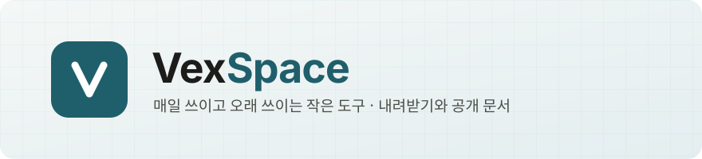

<p align="center">
  <a href="https://vexspace.github.io/"></a>
</p>

<p align="center">
  <a href="https://github.com/vexspace/vexspace.github.io/actions/workflows/pages/pages-build-deployment"></a>
  <a href="https://github.com/vexspace/vexspace.github.io/releases?q=pagemark&expanded=true"></a>
  <a href="https://github.com/vexspace/vexspace.github.io/releases"></a>
  
</p>

<p align="center">
  개인 개발자 Vex 가 만드는 작은 도구들을 내려받고, 공개 문서를 보는 곳입니다.
</p>

<p align="center">
  <a href="#overview">Overview</a> •
  <a href="#download">Download</a> •
  <a href="#pagemark">Pagemark</a> •
  <a href="#calit">Calit</a> •
  <a href="#releases">Releases</a> •
  <a href="#get-in-touch">Get in touch</a>
  <br/>
  <a href="https://vexspace.github.io/" target="_blank">🌐 사이트</a> •
  <a href="https://vexspace.github.io/pagemark/" target="_blank">📖 Pagemark</a> •
  <a href="https://vexspace.github.io/calit/" target="_blank">📅 Calit</a> •
  <a href="https://github.com/vexspace/vexspace.github.io/releases" target="_blank">📦 모든 파일</a>
</p>

---

# Overview

[VexSpace](https://vexspace.github.io/) 는 개인 개발자 Vex 가 운영하는 작은 공간입니다. 일상에서 직접 겪은 불편에서 출발해, 하나의 문제를 끝까지 풀어내는 작은 도구를 만듭니다.

이 저장소는 그 공개 사이트(GitHub Pages)입니다. 등록된 프로젝트마다 소개 페이지, 개인정보 처리방침 같은 공개 문서, 그리고 **설치 파일 내려받기**를 제공합니다. 설치 파일은 이 저장소의 [Releases](https://github.com/vexspace/vexspace.github.io/releases) 에 있습니다.

| | 프로젝트 | 소개 | 플랫폼 | 내려받기 |
|:-:|---|---|---|---|
|  | [**Pagemark**](#pagemark) | 마크다운 문서를 전자책처럼 한 장씩 넘겨 읽는 뷰어 | Android · macOS | ✅ [바로 받기](#pagemark) |
|  | [**Calit**](#calit) | 기기 캘린더의 일정과 TODO 를 위젯·잠금 화면에서 보고 정리하는 앱 | Android | ⏳ 출시 준비 중 |

# Download

가장 쉬운 방법은 각 프로젝트 페이지에서 기기에 맞는 파일을 고르는 것입니다 — 방문한 기기에 맞는 항목이 먼저 보입니다.
파일을 직접 받으려면 아래 링크나 명령을 쓰세요.

## Pagemark


마크다운 문서를 전자책처럼 한 장씩 넘겨 읽는 뷰어입니다. 폴더 트리, 문서 사이 링크 이동, 쪽 넘김·스크롤 보기, 보이는 그대로 고치는 편집 모드(자동 저장)를 제공합니다.

📖 [소개 · 내려받기 페이지](https://vexspace.github.io/pagemark/) · 🔒 [개인정보 처리방침](https://vexspace.github.io/pagemark/privacy.html) · 📦 [모든 버전](https://github.com/vexspace/vexspace.github.io/releases?q=pagemark&expanded=true)

### macOS (Apple Silicon)

[**Pagemark-1.2.0-arm64.dmg**](https://github.com/vexspace/vexspace.github.io/releases/download/pagemark-v1.2.0/Pagemark-1.2.0-arm64.dmg) (131 MB) 를 받아 열고, Pagemark 를 응용 프로그램 폴더로 옮기세요.

```bash
curl -LO https://github.com/vexspace/vexspace.github.io/releases/download/pagemark-v1.2.0/Pagemark-1.2.0-arm64.dmg
open Pagemark-1.2.0-arm64.dmg
```

> **참고**: 아직 Apple 공증을 받지 않았습니다. 처음 열 때 "확인되지 않은 개발자" 경고가 뜨면 Finder 에서 Pagemark 를 우클릭 › **열기** 를 누르세요.

### Android

[**Pagemark-1.2.0.apk**](https://github.com/vexspace/vexspace.github.io/releases/download/pagemark-v1.2.0/Pagemark-1.2.0.apk) (5.3 MB) 를 휴대폰에서 받아 여세요. 컴퓨터에 연결해 설치할 수도 있습니다.

```bash
curl -LO https://github.com/vexspace/vexspace.github.io/releases/download/pagemark-v1.2.0/Pagemark-1.2.0.apk
adb install Pagemark-1.2.0.apk
```

> **참고**: 설치할 때 "출처를 알 수 없는 앱" 허용이 필요합니다. Google Play 에서 받은 Pagemark 와는 서명이 달라 서로 위에 설치되지 않습니다.

### 업데이트

앱이 켜질 때 새 버전을 확인합니다. 꼭 필요한 업데이트가 나오면 앱 안에서 안내하고, **업데이트** 를 누르면 새 설치 파일을 받습니다 —
버전 정보는 [`/pagemark/version.json`](https://vexspace.github.io/pagemark/version.json) 에 있습니다.

## Calit


기기 캘린더의 일정과 TODO 를 위젯과 잠금 화면에서 바로 보고 정리하는 Android 앱입니다.

📅 [소개 페이지](https://vexspace.github.io/calit/) · 🔒 [개인정보 처리방침](https://vexspace.github.io/calit/privacy.html)

> ⏳ **출시 준비 중** — Google Play 로 출시할 예정입니다. 출시되면 이 자리에 내려받기 방법이 생깁니다.

# Releases

설치 파일은 프로젝트별 태그(`<프로젝트>-v<버전>`)로 [Releases](https://github.com/vexspace/vexspace.github.io/releases) 에 올라갑니다.

| 프로젝트 | 최신 | 파일 |
|---|---|---|
| Pagemark | [`pagemark-v1.2.0`](https://github.com/vexspace/vexspace.github.io/releases/tag/pagemark-v1.2.0) | macOS `.dmg` · Android `.apk` |
| Calit | — | 출시 준비 중 |

각 릴리스 설명에 SHA-256 체크섬이 있습니다. 받은 파일을 확인하려면:

```bash
shasum -a 256 Pagemark-1.2.0-arm64.dmg Pagemark-1.2.0.apk
```

# Maintaining

<details>
<summary>새 버전 내보내기 · 로컬 미리 보기 · 파일 소유</summary>

### 새 버전 내보내기

1. 설치 파일을 Releases 에 `<프로젝트>-v<버전>` 태그로 올립니다.
2. 올린 **뒤에** [`_data/versions.yml`](_data/versions.yml) 의 `latest` · `url` · `size` 를 바꿉니다 — 먼저 바꾸면 받을 파일이 없는데 앱이 업데이트를 요구합니다.
3. push 하면 1~2분 뒤 프로젝트 페이지의 내려받기와 `version.json` 이 바뀝니다. 이 README 의 버전 링크도 함께 바꿉니다.

`versions.yml` 의 `minimum` 은 비상시에만 적습니다(끝자리 업데이트도 강제할 때). 비우면 `latest` 의 끝자리를 0 으로 바꾼 값이 최소 버전입니다.

### 로컬 미리 보기

GitHub Pages 와 같은 Jekyll 3.10 으로 확인하세요. `` 인자에는 `p[1].icon` 같은 대괄호 값을 넣을 수 없습니다 — `` 으로 먼저 담으세요.

```bash
gem install jekyll -v 3.10.0 && gem install kramdown-parser-gfm
jekyll serve        # → http://127.0.0.1:4000/
```

### 파일 소유

| 경로 | 원본 |
|---|---|
| `index.md` · `_layouts/` · `_includes/` · `_data/` · `assets/` · `*/index.md` · `pagemark-version.json` | 이 저장소 |
| `calit/` 안의 문서 (`index.md` 제외) | [`vexspace/calit`](https://github.com/vexspace/calit) 의 워크플로가 교체 |
| `pagemark/` 안의 문서 (`index.md` 제외) | [`vexspace/pagemark`](https://github.com/vexspace/pagemark) 의 워크플로가 교체 |

프로젝트 추가: `_data/projects.yml` 항목 + `assets/icons/<slug>.png`(160px) + `<slug>/index.md`(`layout: project`, `project: <slug>`).
공개 문서는 front matter 에 `layout: doc` · `title` · `project` · `doc: true` · `updated` · `permalink` 를 적습니다.

</details>

# Get in touch

- ✉️ [vexspace.io@gmail.com](mailto:vexspace.io@gmail.com) — 문의 · 오류 제보 · 개인정보 관련 요청
- 🌐 [vexspace.github.io](https://vexspace.github.io/)

---

<p align="center">© VexSpace</p>
